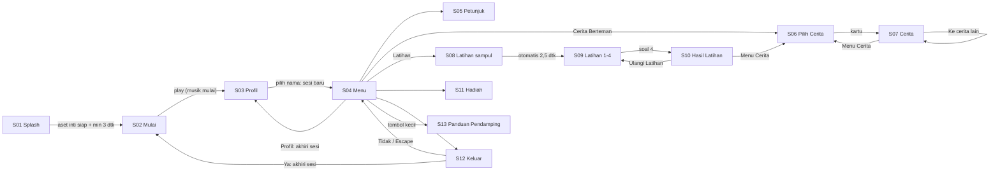
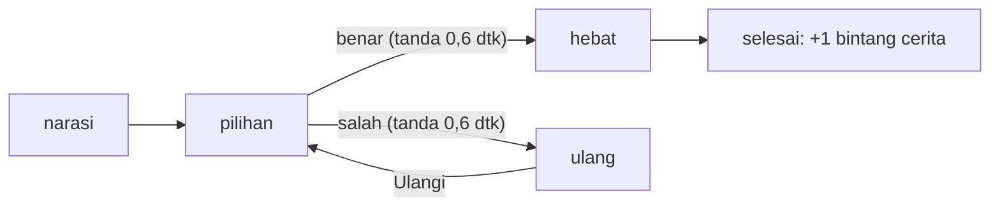
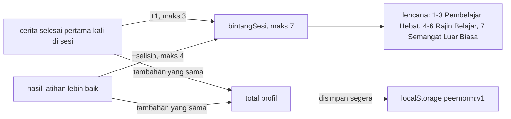

# Alur PeerNorm

Ringkasan peta navigasi dari `PRD-PeerNorm.md` (§4, §5, §6, §8), dipetakan dengan graphify (`graphify-out/GRAPH_REPORT.md`). Bila bertentangan, PRD yang berlaku.

## 1. Navigasi layar

- **Beranda** (kiri atas) selalu menuju S04 Menu. Tombol ini tampil di S05 sampai S13.
- **Ke cerita lain**: giliran ke berbagi ke perubahan, lalu kembali ke giliran (A11).
- **Overlay "Putar layar"** menutupi semua layar saat perangkat portrait.
- **Musik** hidup di S02 sampai S04, mati di layar lain dan saat tab disembunyikan.

## 2. Mesin cerita

| Cerita | Jalur |
|---|---|
| `giliran` | narasi 1/4, 2/4, pilihan 3/4, hebat 4/4 (atau ulang 4/4), selesai |
| `berbagi` | narasi 1/6 sampai 4/6, pilihan 5/6, hebat 6/6 (atau ulang 6/6), selesai |
| `perubahan` | narasi 1/6 sampai 3/6, pilihan 4/6, hebat (tanpa nomor), terima 5/6, pelajaran 6/6, selesai. Salah: ulang 5/6 |

Halaman pilihan tidak punya panah lanjut (A8). Data ada di `src/data/cerita.ts`.

## 3. Latihan

4 soal tetap (L1 sampai L4). Posisi kartu diacak tiap tampil. Satu kali jawab per soal, sorot netral 0,4 dtk, tanpa tanda benar/salah. Jumlah benar = bintang latihan.

## 4. Bintang dan lencana

- **Sesi**: dimulai saat memilih profil, berakhir di Menu > Profil, Keluar > Ya, atau saat halaman dimuat ulang. `bintangSesi` mulai dari 0.
- **Tampilan**: Profil dan Menu menampilkan `total`; Hadiah menampilkan `bintangSesi` dan lencana aktif.
- Aturan ada di `src/engine/bintang.ts` dan dites di `src/engine/bintang.test.ts`.

## 5. Keputusan terbuka (perlu konfirmasi klien)

- **Beranda di Profil dan Menu.** AC-15 meminta Beranda di semua layar kecuali S01 dan S02. Di Menu, Beranda tidak melakukan apa pun karena tujuannya Menu itu sendiri. Di Profil belum ada profil aktif, jadi Menu tidak punya data. Kerangka ini menyembunyikan Beranda di dua layar tersebut.
- **Musik di S05, S06, S11, S13.** PRD §10.3 menyebut musik hidup di S02 sampai S04 dan memudar saat masuk cerita/latihan. Status musik di layar Menu lainnya tidak disebut. Kerangka ini mematikan musik di semua layar di luar S02 sampai S04.

